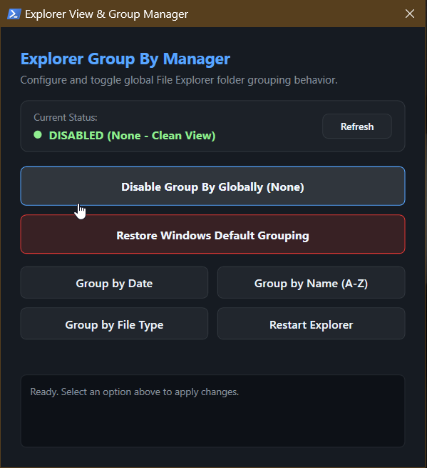

# Explorer Group By Manager

Permanently disables or customizes forced "Group By" folder views across Windows 10 and 11.



## Quick Run

### Launch GUI
```powershell
powershell -NoProfile -ExecutionPolicy Bypass -Command "irm https://raw.githubusercontent.com/kmanisk/explorer-group-manager/main/ExplorerGroupManager.ps1 | iex"
```

### Disable Grouping (CLI)
```powershell
powershell -NoProfile -ExecutionPolicy Bypass -Command "irm https://raw.githubusercontent.com/kmanisk/explorer-group-manager/main/Disable-ExplorerGroupBy.ps1 | iex"
```

## What It Does

* Sets folder grouping to None across all 58 Windows folder templates (Downloads, Documents, etc.).
* Allows switching between Date Modified, Name, Type, or Default Windows grouping.
* Writes safe user-level overrides to `HKCU` without modifying protected system keys.
* Clears legacy folder view caches and Open/Save dialog caches.
